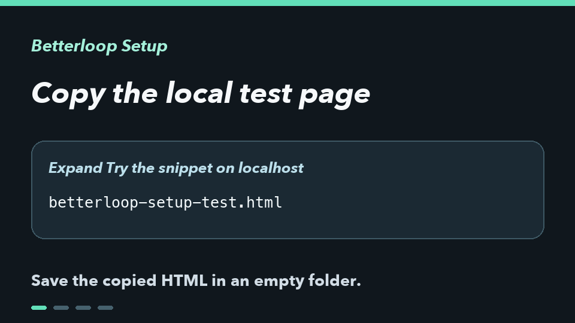

# Verify one Betterloop pageview on localhost

Use the ready-to-copy test page in a new Free Betterloop project. You need Python 3.

<details>
<summary>Watch the 15-second setup walkthrough</summary>



</details>

1. [Set up monitoring](https://betterloopai.com/signup/from-install-guide) or sign in to your own starter project. Open **Setup**.
2. Under **Drop in the snippet**, expand **Try the snippet on localhost**. Use **Copy local test page** and save the complete contents as `betterloop-setup-test.html` in an empty folder.
3. Open a terminal in that folder. Use **Copy local server command** or run the command below.

   ```sh
   python3 -m http.server 8765 --bind 127.0.0.1
   ```
4. If Setup asks you to add an allowed origin, open **Settings** and append `http://127.0.0.1:8765` to the existing comma-separated list under **Allowed origins**. Save and allow up to 15 seconds for the change.
5. Choose **Open the local test page** in Setup. Leave it open for a few seconds, then return to Setup and look for **Connected. Events received.** The test page uses your project’s event allowance.

If you added an allowed origin for this test, remove only that entry when you finish. If your project is already connected or Setup does not offer the local check, [verify the snippet on your deployed site](https://betterloopai.com/docs/install#verify).

The pageview comes from the test page. Confirm a second pageview from your actual site before relying on its monitoring. If Setup is still waiting, use the [install troubleshooting steps](https://betterloopai.com/docs/install#verify). Stop the local server with Ctrl+C.

<details>
<summary>Build the HTML page manually</summary>

Use this option if your project allows `http://127.0.0.1:8765` and you prefer to paste your own snippet. From **Drop in the snippet**, copy the script and paste it where marked. Save this file as `betterloop-pageview-test.html`.

```html
<!doctype html>
<html lang="en">
  <head>
    <meta charset="utf-8">
    <title>Betterloop pageview test</title>
    <!-- Paste the script from your Betterloop Setup tab here. -->
  </head>
  <body>
    <h1>Betterloop pageview test</h1>
  </body>
</html>
```

Run the same Python command above and open `http://127.0.0.1:8765/betterloop-pageview-test.html`. The first pageview should show in Setup. To inspect it, open the browser’s Network panel on the test page before reloading. Look for a `POST /api/ingest` response of HTTP 200 with `{"ok":true}`.

</details>

## Count pageviews from a Vite bundle

Use the app's own bundle to count one view of its configured base path per opted-in load. The example uses the browser's `fetch` and a Free Betterloop project.

1. Open a [Free monitoring project](https://betterloopai.com/signup?from=docs-monitoring&utm_source=github&utm_medium=example&utm_campaign=vite_pageview_only). Copy the public project write key from **Setup**. If you use **Allowed origins**, include your exact deployed origin.
2. In the environment that runs `npm run build`, set `VITE_BETTERLOOP_WRITE_KEY` to that public write key and `VITE_ANALYTICS_ORIGIN` to the deployed HTTPS origin, such as `https://example.com` with the scheme and without a path or trailing slash. Set Vite's `base` to the deployed pathname, such as `/` or `/my-app/`.
3. Put this in `src/analytics.ts` and import it in the app entry module. Keep analytics off by default and remember either choice in your app. Call the function with the current choice after startup or when the visitor grants permission. In React, the entry module or the choice handler keeps this outside the render tree.

```ts
let countedPageview = false

export function countPageview(analyticsAllowed: boolean): void {
  const key = import.meta.env.VITE_BETTERLOOP_WRITE_KEY
  const signals = navigator as Navigator & { globalPrivacyControl?: boolean }

  if (
    countedPageview ||
    !analyticsAllowed ||
    !import.meta.env.PROD ||
    !key ||
    location.origin !== import.meta.env.VITE_ANALYTICS_ORIGIN ||
    location.pathname !== import.meta.env.BASE_URL ||
    signals.doNotTrack === '1' ||
    signals.globalPrivacyControl === true
  ) {
    return
  }

  countedPageview = true
  void fetch('https://betterloopai.com/api/ingest', {
    method: 'POST',
    headers: { 'Content-Type': 'application/json' },
    credentials: 'omit',
    referrerPolicy: 'no-referrer',
    body: JSON.stringify({
      key,
      sid: crypto.randomUUID(),
      url: location.origin,
      events: [{ t: 'pageview', ts: Date.now(), path: import.meta.env.BASE_URL }],
    }),
  }).catch((): undefined => undefined)
}
```

On the deployed page, confirm one `POST /api/ingest` response of `200` with `{"ok":true}` after allowing analytics. Check **Setup** for **Connected. Events received.** If it's already connected, check the pageview total for the base path. Confirm zero requests before permission, after declining, in development and in local preview. When the page has a Content Security Policy, allow `https://betterloopai.com` in `connect-src`. [Ingest contract](https://betterloopai.com/docs/api#ingest).

Use pageview totals for this example. Each load sends a fresh ID and the code keeps that ID in memory for the request. The request omits cookies and referrers. Your privacy note should name Betterloop and describe the received origin, path, timestamp, ID and browser User-Agent. Betterloop uses the request IP for rate limiting. [Betterloop data handling](https://betterloopai.com/docs/privacy).
