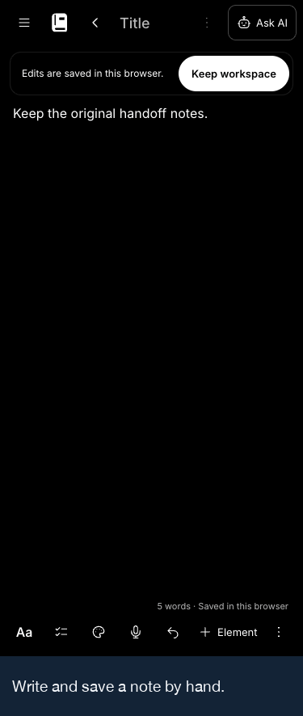

# Test an assistant's Undo

When an assistant and a person edit the same workspace, check exactly what Undo restores. This two-minute exercise uses Plainer, a workspace by this repository's author. Its guest mode uses built-in guidance and saves edits in this browser.

1. In a fresh signed-out window, [open the guest workspace](https://plainer.app/try?utm_source=github&utm_medium=example&utm_campaign=plainer-assistant-undo). Choose **Take a note…**, type **Keep the original handoff notes.** and wait for it to save.
2. Open **All** from the file navigation, then open the **Assistant** and send `Show me around`. Check that the Assistant panel has no Undo button after the reply.
3. Send `Start my own note`. The Assistant creates a second note and offers **Undo last change**.
4. Choose **Undo last change**, close the Assistant and return to **All**. The new note is gone. Open **Untitled.plainer**, whose preview starts with the sentence you typed. Check that its text is intact and survives a reload.

For your own agent, save the before state when the assistant makes a real edit. Recheck that the same change is still eligible after pending saves finish. Exercise read-only replies, no-op writes and a manual edit made after the assistant's change.

If you need more assistant capacity, [compare Free and Pro](https://plainer.app/pricing?utm_source=github&utm_medium=example&utm_campaign=plainer-assistant-undo#pricing-pro). The monthly Pro option renews at $8 after its 14-day trial unless cancelled. The trial requires a card.
